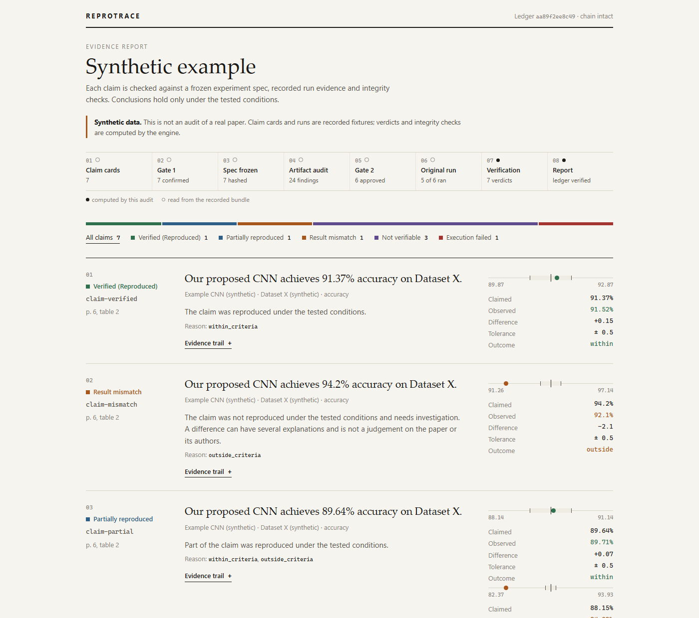
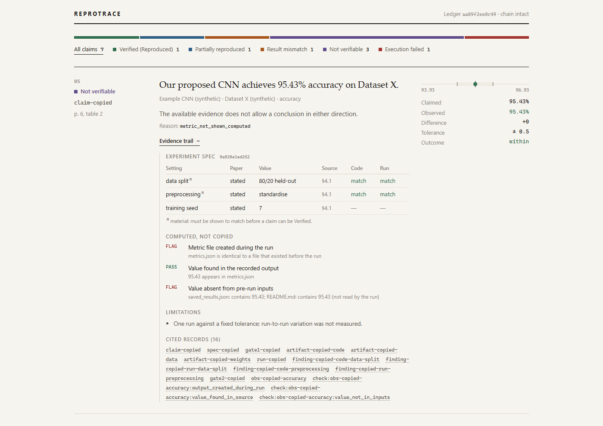
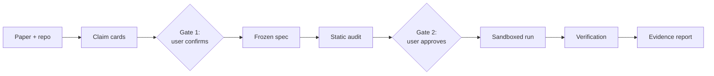

# REPROTRACE

**Other tools run the code. REPROTRACE verifies the claim.**

REPROTRACE checks each claim in a machine-learning paper against its code, its data and an
independently recorded run. It returns a verdict for every claim, and every verdict links to
the evidence it rests on.




> **Synthetic data.** The screenshots show the bundled demo audit. No real paper has been
> audited yet.

---

## The problem

Research code often runs. The harder question is whether the experiment that ran actually
supports the claim in the paper. A number can match for the wrong reason: a different
method, a different data split, or a value read from a saved file instead of computed.

For each claim, REPROTRACE asks three questions:

1. **Implementation.** Does the code match the method the paper describes?
2. **Execution.** Did the run follow the intended configuration?
3. **Results.** Do the observed numbers agree with the claim, within criteria fixed *before*
   the run?

It is a claim verification and audit system, not a paper-reproduction agent. Conclusions
hold under the tested conditions. They are never a judgement on a paper or its authors.

## A matching number is not enough



This claim reports 95.43% and the run reports 95.43%, yet the verdict is **Not verifiable**.
The integrity checks show that the metric file is identical to one that existed before the
run, and that the value already sat in a pre-run input. REPROTRACE only accepts a number
when it can show that the run computed it:

| Check | Question |
|---|---|
| Output created during the run | Was the metric file written by this run? |
| Value found in the recorded output | Does the number come from what the run produced? |
| Value absent from pre-run inputs | Was the number already sitting in the repository? |

Each check states what it can and cannot show. None of them is proof on its own.

## How it works



- **The spec is the single source of truth.** Comparison criteria are fixed and hashed
  before the run. Re-freezing afterwards is detected.
- **Evidence goes around the executor.** The verifier reads the paper, the approved spec and
  the recorded evidence, never the execution agent's summary. LLM output is never evidence.
- **Everything goes into a hash-chained ledger.** Records and files are chained so that
  edits and deletions show. A verdict without evidence ids is invalid.
- **Two trust zones.** Paper and repository text is untrusted data. It cannot change
  instructions, and it is escaped in every report.

## Verdicts

| Status | When |
|---|---|
| Verified (Reproduced) | Ran under sufficiently matching conditions and met the predefined criteria |
| Partially reproduced | Some criteria met, others not |
| Result mismatch | The run succeeded, but a result missed the criteria |
| Not verifiable | Evidence, data or conditions are missing, or the method differs from the spec, *even when the number matches* |
| Execution failed | The run did not complete. The cause is classified |

The decision order is deterministic and the first rule that applies decides. A matching
number from the wrong method, or one not shown to be computed in this run, is never
Verified.

## Quick start

You need [uv](https://docs.astral.sh/uv/) and Python 3.12.

```bash
git clone https://github.com/Technomaniac143/REPROTRACE.git
cd REPROTRACE
uv venv --python 3.12
uv sync --locked
uv run reprotrace audit fixtures/synthetic
```

```text
claim-verified: Verified (Reproduced) (within_criteria)
claim-mismatch: Result mismatch (outside_criteria)
claim-partial: Partially reproduced (within_criteria, outside_criteria)
claim-wrong-method: Not verifiable (method_mismatch)
claim-copied: Not verifiable (metric_not_shown_computed)
claim-missing-data: Not verifiable (essential_artifact_missing)
claim-failed: Execution failed (run_failed)
report: evidence/audit-<time>/report.md
dashboard: evidence/audit-<time>/dashboard.html
```

Open `dashboard.html` in a browser. It is a single offline file that makes no network
requests, and it follows the system's light or dark theme. Run the tests with
`uv run pytest -q`.

## What works today

| Part | State |
|---|---|
| Record schemas, hash-chained ledger | Built, tested |
| Spec freezing, metric comparison, verdict engine | Built, tested |
| Computed-not-copied checks | Built (basic) |
| Markdown report, HTML dashboard | Built, tested |
| Claim extraction from PDF | Next. Claims are supplied as recorded fixtures for now |
| Static repository audit | Planned |
| Sandboxed execution | Blocked until an isolated sandbox exists. Third-party code is never run on the host |

## Layout

```text
src/reprotrace/
  schemas/        Claim, ExperimentSpec, RunRecord, Verdict, ...
  evidence/       hash-chained ledger, file hashing
  verification/   freezing, comparison, integrity checks, verdict engine
  report/         Markdown report
  ui/             HTML dashboard
  orchestrator/   recorded-audit pipeline
  cli.py          reprotrace audit <bundle>
fixtures/         hashed synthetic bundle
tests/            pytest suite
```

## Roadmap

- [x] Verification core on synthetic evidence
- [x] HTML evidence dashboard
- [ ] PDF to grounded claim cards, with confirmation at gate 1
- [ ] Static artifact and consistency audit of a public repository
- [ ] Sandboxed original run with no network access
- [ ] End-to-end audit of one small public paper

Design notes and the current plan are in [`Project.md`](Project.md) and [`Plan.md`](Plan.md).
The full project rationale is in
[`REPROTRACE_Full_Project_Document.md`](REPROTRACE_Full_Project_Document.md).

---

Team IMPACT, Chennai Institute of Technology. K! Hacks 4.0, Agentic AI track.
